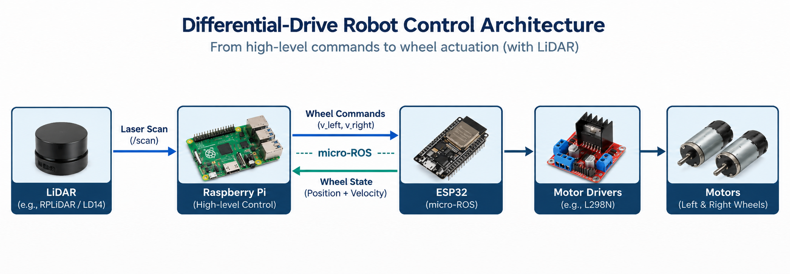
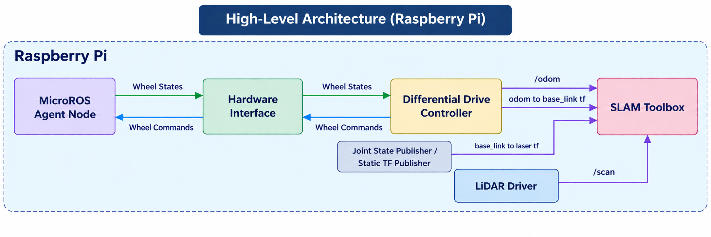
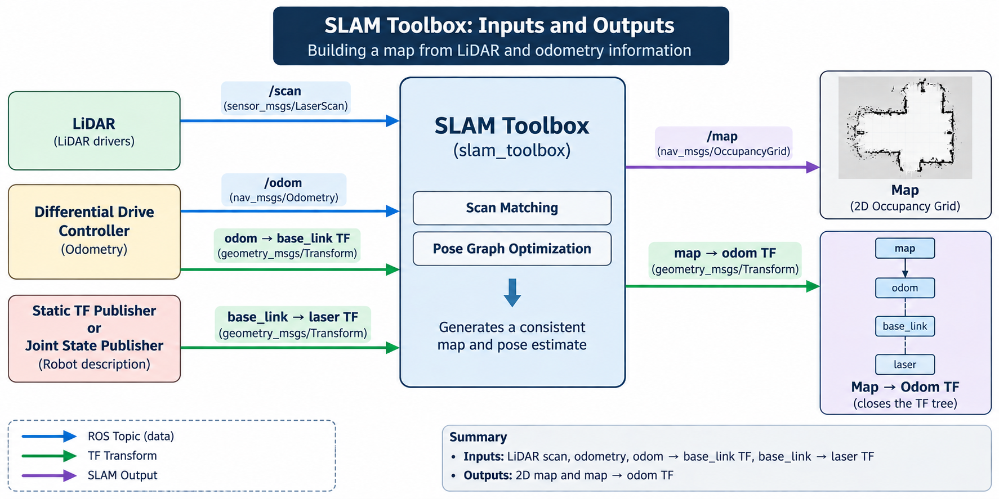
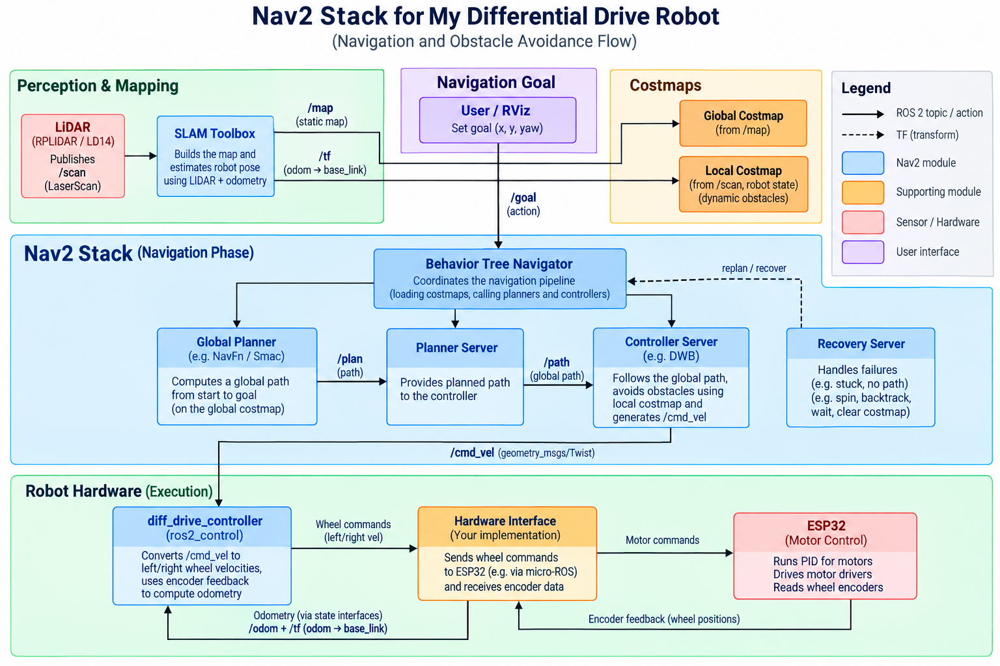

# Project introduction slides

These slides come from the deck our seniors in the Robotics Society, IIT Jodhpur used to introduce the AMR project to the team. They show the system architecture we built towards.

## 1. Differential-drive robot control architecture

From high-level commands to wheel actuation: LiDAR, Raspberry Pi, ESP32 over micro-ROS, motor drivers and motors.

## 2. High-level architecture on the Raspberry Pi

The micro-ROS agent, hardware interface and differential drive controller, plus the LiDAR driver and TF publishers feeding SLAM Toolbox.

## 3. SLAM Toolbox inputs and outputs

How `/scan`, `/odom` and the TF transforms go in, and the 2D occupancy map and `map → odom` transform come out.

## 4. Nav2 stack for the differential-drive robot

The navigation and obstacle avoidance flow, from a goal set in RViz through the planners and controller down to the ESP32.

For the architecture as it was finally implemented, see [../architecture.md](../architecture.md).
